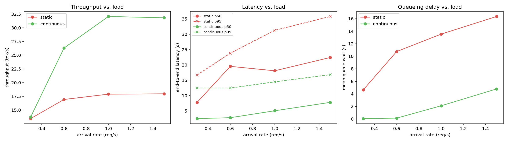
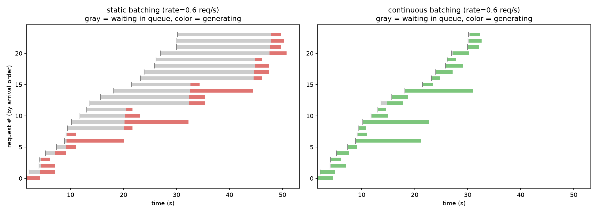

# Continuous Batching vs. Static Batching

A from-scratch implementation of the scheduling mechanism behind modern
LLM inference servers (vLLM, TGI, TensorRT-LLM) — **continuous batching**
— benchmarked against naive static batching under Poisson request arrivals.
Qwen2.5-3B-Instruct on an M3 MacBook (PyTorch MPS backend, fp16).

## The problem

Requests arrive at random times, each wanting a different number of output
tokens. Batching decode steps together is what gets good GPU utilization.

- **Static batching**: group arrivals into a fixed-size batch, run it until
  every member finishes, then admit the next batch. One long request holds
  up everyone else in its batch — and anyone who arrived after.
- **Continuous batching**: at every decode step, evict finished requests
  and admit new ones immediately. No one waits for a stranger's long
  response.

## What's here

- [`engine.py`](engine.py) — `prefill()` builds a request's KV cache;
  `decode_step()` runs one batched forward pass across requests whose KV
  caches have *different lengths* (left-padded + masked) — the core trick
  continuous batching needs.
- [`schedulers.py`](schedulers.py) — `run_static` / `run_continuous`, same
  engine, different admission policy.
- [`workload.py`](workload.py) — Poisson arrivals with a heavy-tailed mix
  of short and long generations (length variance is what creates
  stragglers).
- [`bench.py`](bench.py) / [`plot.py`](plot.py) — run the sweep, plot the
  results.

**Not implemented** (out of scope for a weekend build): paged attention,
chunked prefill, custom CUDA kernels. KV caches are re-padded every step
instead. Paged attention is a memory-efficiency layer on top of continuous
batching, not a prerequisite for the scheduling win shown here.

## Results

24 requests, max batch size 4, Qwen2.5-3B-Instruct on M3 MPS:

| rate (req/s) | scheduler | throughput (tok/s) | latency p50 | mean queue wait |
|---|---|---|---|---|
| 0.6 | static | 16.9 | 19.53s | 10.75s |
| 0.6 | continuous | 26.3 | 2.80s | 0.13s |
| 1.5 | static | 18.0 | 22.43s | 16.35s |
| 1.5 | continuous | 31.8 | 7.79s | 4.78s |



Static batching's throughput plateaus around 18 tok/s regardless of load —
it can't use spare capacity because admission is blocked until the whole
batch finishes. Continuous batching reaches ~32 tok/s and keeps queue wait
close to zero until the system is genuinely saturated.

The timeline (gray = queued, color = generating) makes it visible directly,
at rate=0.6 req/s:



Static batching takes ~50s to clear the same 24 requests that continuous
batching clears in ~33s — visible directly in how much longer the gray
"waiting" bars are throughout the run.

## Running it

```bash
python3.12 -m venv .venv && source .venv/bin/activate
pip install -r requirements.txt
python bench.py   # ~2-3 min
python plot.py
```
